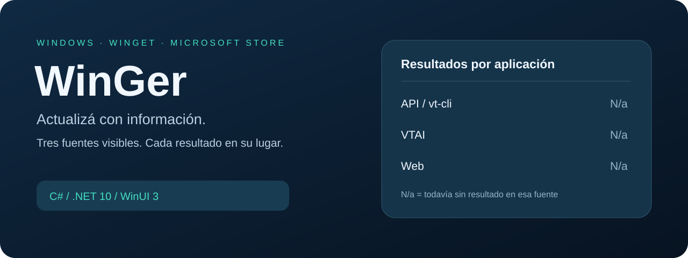

<p align="center">
  
</p>

<h1 align="center">WinGer</h1>
<p align="center"><strong>Actualizá Windows con información, a tu ritmo.</strong><br />WinGet · Microsoft Store · VirusTotal</p>

<p align="center">
  <a href="https://github.com/GermanBartoli/WinGer/releases"></a>
  
  
  
</p>

<p align="center">
  <a href="https://github.com/GermanBartoli/WinGer/releases">Descargar</a> ·
  <a href="#primeros-pasos">Primeros pasos</a> ·
  <a href="#qué-conviene-consultar">API, VTAI o Web</a> ·
  <a href="#cómo-leer-las-tarjetas">Resultados</a> ·
  <a href="#desarrollo">Desarrollo</a>
</p>



*Esquema de orientación; no es una captura de la aplicación. N/a significa que esa fuente todavía no tiene un resultado registrado.*

## Qué podés hacer

| Actualizaciones | Información | Tu escritorio |
| --- | --- | --- |
| Buscar programas con WinGet y seleccionar varios. | Consultar el hash publicado antes de descargar. | Icono propio en EXE, ventana, bandeja y acceso directo. |
| Verificar el instalador y actualizar con avisos claros. | Conservar resultados separados de API/vt-cli, VTAI y Web. | Recordar filtros, selección y consultas entre sesiones. |
| Consultar Microsoft Store y abrir su página de descargas. | Ver el motivo de cada bloqueo y sus detalles. | Usar tema claro, oscuro o del sistema. |

> **Cero detecciones no garantiza seguridad.** Consultar un informe existente tampoco significa que se haya analizado de nuevo el archivo.

## Primeros pasos

1. Descargá el ZIP **win-x64** desde [Releases](https://github.com/GermanBartoli/WinGer/releases).
2. Extraé **todo el contenido** en una carpeta permanente y abrí `WinGer.exe`. La distribución incluye .NET y Windows App SDK.
3. En **Configuración**, elegí cómo consultar al buscar actualizaciones: **VTAI**, **Web experimental** o **Desactivado**.
4. Pulsá **Buscar actualizaciones**. Cada tarjeta muestra el programa, sus versiones y los resultados por fuente.
5. Para instalar, pulsá **Actualizar** y revisá la confirmación. Las advertencias y los errores aparecen en pantalla.

**Requisitos:** Windows 10 1809 o posterior / Windows 11, x64. WinGet y vt-cli se instalan por separado y deben estar disponibles en PATH. Reiniciá WinGer si los instalaste mientras estaba abierto. Las funciones de Microsoft Store requieren una versión compatible de la tienda.

La consulta API y la actualización verificada requieren tu clave clásica de VirusTotal en **Configuración**. VTAI usa su propio token, que WinGer registra una sola vez y protege en Windows; también admite importar uno existente. El repositorio no incluye credenciales.

Para actualizar WinGer, cerralo desde **bandeja → Salir** y reemplazá los archivos de su carpeta. La configuración vive fuera de esa carpeta. El ejecutable de esta vista previa no tiene firma de editor; cada release incluye el SHA-256 del ZIP.

## Qué conviene consultar

**La recomendación para WinGer:** VTAI para revisar automáticamente la lista, Web para inspeccionar detalles a mano y API/vt-cli para el flujo de actualización verificada.

| Opción | Para qué sirve | Acceso y límites | En WinGer |
| --- | --- | --- | --- |
| **API / vt-cli** | Respuestas estructuradas y comprobación del hash antes de instalar. | Usan la misma clave clásica y su cuota. vt-cli no agrega otro motor antivirus. | **Consultar API** actualiza esta fila; al instalar, vt-cli revalida el informe y queda identificado en los detalles. |
| **VTAI** | Consultar automáticamente reputación sin configurar una clave clásica. | Token propio reutilizable y cuotas propias; no es ilimitado ni un antivirus independiente. | Se elige en Configuración. Conserva su resultado en una fila separada. |
| **Web** | Revisar manualmente motores, fechas y detalles del informe. | Abrir la página no utiliza tu clave API; la web puede pedir verificaciones. | **Ver web** solo abre el informe. **Leer web · experimental** intenta importar la evidencia visible y actualiza la fila Web. |

La [API pública](https://docs.virustotal.com/docs/difference-public-private) publica un límite de cuatro interacciones por minuto. [vt-cli](https://virustotal.github.io/vt-cli/) utiliza una clave de esa API. [VTAI](https://docs.virustotal.com/docs/vtai-overview) ofrece acceso mediante su propia conexión y cuotas. Son vías de acceso a VirusTotal: no conviene contar tres consultas como tres análisis independientes.

WinGer reutiliza informes API y VTAI durante una hora y espacia solicitudes. Las consultas externas hechas fuera de WinGer también pueden consumir la cuota de tu clave. Ante errores de cuota, la aplicación no cambia automáticamente de fuente para eludir el límite.

## Cómo leer las tarjetas

Cada tarjeta conserva tres renglones pequeños:

```text
API / vt-cli: N/a
VTAI:         N/a
Web:          N/a
```

Arriba tenés **Consultar API**, **Consultar VTAI**, **Leer Web** y **Consultar las 3**. Actúan sobre las aplicaciones seleccionadas; usá **Seleccionar visibles** para incluir todas las que muestra el filtro. **Consultar las 3** recorre las fuentes en orden, conserva su caché vigente y no instala programas. La lectura Web puede requerir intervención. La instalación sigue en **Actualizar programas seleccionados…**.

Después de consultar aparecen las detecciones, las sospechas y la fecha/hora de consulta. **Ver detalles / error** muestra el método, el hash, la fecha del informe y el resultado de cada fuente, además de la última operación.

- **Buscar actualizaciones no borra la fila API.** Una consulta VTAI o Web modifica únicamente su propio resultado.
- Un intento fallido conserva la evidencia anterior y agrega **último intento falló**; el motivo se puede leer en los detalles.
- Los resultados sobreviven al reinicio y se conservan al buscar la misma aplicación y versiones. Si cambia la versión o el hash, no se reutiliza evidencia de otro instalador.
- **N/a** significa que no hay resultado registrado; **Sin informe** significa que la consulta no devolvió un informe existente. Ninguno significa “seguro”.
- La caché anterior puede recuperar API y VTAI por hash. Un informe Web antiguo no se reconstruye a partir de un mensaje: hay que leerlo de nuevo.

| Color | Cómo interpretarlo |
| --- | --- |
| 🟢 Verde | Informe completo y reciente sin detecciones ni sospechas. Antes de instalar aún se verifica el archivo real. |
| 🟡 Amarillo | Falta información, el informe es antiguo, hubo un error o hay una advertencia. La lectura Web sin detecciones permanece informativa. |
| 🔴 Rojo | Hay detecciones, sospechas o un bloqueo de integridad. |
| ⚪ Gris | Todavía no hay consulta registrada. |

El estado principal de la tarjeta describe la **última operación**; las tres filas conservan la evidencia de cada fuente. La fecha de consulta puede ser posterior a la del análisis de VirusTotal y puede corresponder a una lectura desde caché.

## Actualizar con advertencias claras

1. WinGet descarga el instalador y el manifiesto de la versión seleccionada.
2. WinGer calcula el SHA-256 del archivo real y lo compara con el manifiesto.
3. Comprueba la firma digital y consulta el informe de VirusTotal.
4. Antes de ejecutar, vuelve a verificar el hash, la firma y el informe mediante vt-cli.
5. Ejecuta el archivo local comprobado y consulta la versión instalada.

Una firma ausente o no comprobable puede mostrar **Actualizar igualmente**. La aceptación se aplica a ese instalador y conserva una advertencia amarilla al terminar. **No permite omitir un hash incorrecto, detecciones, una firma no confiable ni la falta de un informe admisible.**

Los errores se muestran automáticamente con su motivo. Siempre podés volver a abrir **Ver detalles / error**. Cancelar detiene la cola; no interrumpe un instalador que ya comenzó.

<details>
<summary><strong>Formatos y límites de instalación</strong></summary>

- MSI/WiX y EXE/Inno/Nullsoft/Burn: sin dependencias declaradas ni desinstalación previa requerida.
- MSIX/AppX: instalación mediante [Add-AppxPackage](https://learn.microsoft.com/en-us/powershell/module/appx/add-appxpackage?view=windows-11). Windows valida su firma y las dependencias presentes; si faltan, la operación se rechaza.
- El informe debe tener motores analizados, cero detecciones, cero sospechas y una fecha dentro de los últimos 30 días. La comprobación local vence después de una hora.
- Se mantiene el archivo abierto con bloqueo de escritura durante la instalación; no se vuelve a descargar mediante WinGet.
- Los EXE pueden mostrar asistentes y los MSI no solicitan un reinicio automático. Windows puede pedir permisos.
- Un instalador puede descargar componentes adicionales fuera del análisis del archivo inicial.
- La lectura Web es informativa y no habilita la instalación. Una versión final que no coincida exactamente queda pendiente de confirmar.
- Se omiten versiones desconocidas e identificadores truncados. No hay actualizaciones programadas.

</details>

## Microsoft Store

La sección **Microsoft Store** consulta actualizaciones e inventario mediante la herramienta oficial [Store CLI](https://blogs.windows.com/windowsdeveloper/2026/02/11/enhanced-developer-tools-on-the-microsoft-store/).

**Abrir Store para actualizar** lleva a la página de descargas de la tienda. La instalación se completa allí; después podés volver a consultar desde WinGer. Esta sección no analiza esos archivos con VirusTotal ni consume tu cuota API. Si `store.exe` no está disponible, aparece el motivo y se conserva el acceso a la tienda.

## Privacidad y datos locales

| Dato | Dónde queda |
| --- | --- |
| Clave clásica y token VTAI | Administrador de credenciales de Windows. |
| Ajustes, caché e historial | `%LOCALAPPDATA%\WinGer`. |
| Instaladores descargados | `%LOCALAPPDATA%\WinGer\Descargas`. |
| Historial | Últimas 200 operaciones locales. |

Consultar un hash no sube el archivo. Las subidas desde el centro VirusTotal requieren confirmación porque pueden compartir el contenido con terceros. La clave de vt-cli se entrega en el entorno de su proceso, no en los argumentos ni en el historial.

**Borrar caché** elimina búsquedas e informes reutilizables; conserva ajustes, credenciales, historial e instaladores. Los archivos descargados pueden borrarse cuando no haya operaciones en curso y deberán comprobarse de nuevo antes de instalar.

## Novedades de 0.3.1

- Suite ampliada ejecutable sin cursor con `./scripts/Probar.ps1` e informe Markdown.
- Rechazo de estadísticas API incompletas o inválidas, informes con otro hash y cache fechada en el futuro.
- [Cobertura y límites de las pruebas](docs/PRUEBAS.md): las pruebas automáticas no reemplazan la validación visual ni ejecutan instaladores.

## Novedades de 0.3.0

- Tres resultados persistentes por aplicación: **API/vt-cli · VTAI · Web**.
- Conservación de evidencia al buscar actualizaciones o fallar una nueva consulta.
- Icono propio multirresolución para EXE, ventana, bandeja y escritorio.
- README visual con guía de consulta, estados, instalación y Microsoft Store.

Incluye las correcciones de 0.2.1 y la conexión con Microsoft Store de 0.2.2. [Ver versiones publicadas](https://github.com/GermanBartoli/WinGer/releases).

## Desarrollo

Con .NET SDK 10 y herramientas de compilación de Windows:

```powershell
dotnet build src/WinGer/WinGer.csproj -c Release -p:Platform=x64
dotnet run --project tests/WinGer.Pruebas -c Release
./scripts/Publicar.ps1
```

Las pruebas cubren la independencia y persistencia de fuentes, caché, manifiestos, aprobación, parsing de vt-cli y errores HTTP simulados. Para comprobar firmas y la lista real sin instalar ni subir archivos:

```powershell
dotnet run --project tests/WinGer.Pruebas -c Release -- --integracion-winget --integracion-firma
```

Las instalaciones completas y la lectura Web requieren validación manual. El proyecto usa WinUI 3; NotifyIcon de Windows Forms gestiona la bandeja y YamlDotNet interpreta los manifiestos. Los originales del icono se conservan como SVG y PNG sin pérdida; el ICO contiene tamaños de 16 a 256 píxeles.

## Mapa del repositorio

| Ruta | Contenido |
| --- | --- |
| [src/WinGer](src/WinGer) | Ventanas, tarjetas, Microsoft Store y configuración. |
| [src/WinGer.Core](src/WinGer.Core) | Consultas, resultados, caché, procesos y verificaciones. |
| [tests/WinGer.Pruebas](tests/WinGer.Pruebas) | Pruebas sin dependencias adicionales de testing. |
| [src/WinGer/Assets](src/WinGer/Assets) | Icono de la aplicación en ICO, PNG y SVG. |
| [scripts/Publicar.ps1](scripts/Publicar.ps1) | Distribución autónoma para Windows x64. |

## Autoría

Creado y mantenido por **[Germán Bartoli](https://github.com/GermanBartoli)**, con colaboración de **Codex**. Proyecto independiente inspirado en el tipo de experiencia de [UniGetUI](https://github.com/Devolutions/UniGetUI); no incorpora su código ni sus recursos. Sin afiliación con Microsoft ni VirusTotal.

<!-- firma-german-bartoli -->
<p align="center">
  <a href="https://germanbartoli.pages.dev/">
    <br />
    Hecho por Germán Bartoli · Ver portfolio
  </a>
</p>
